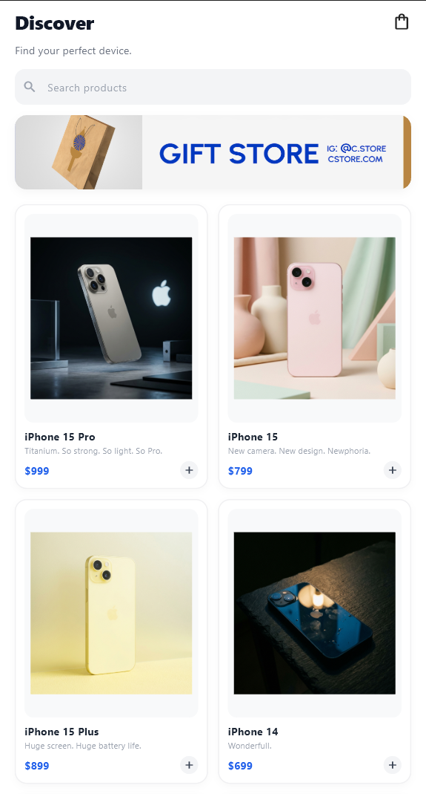
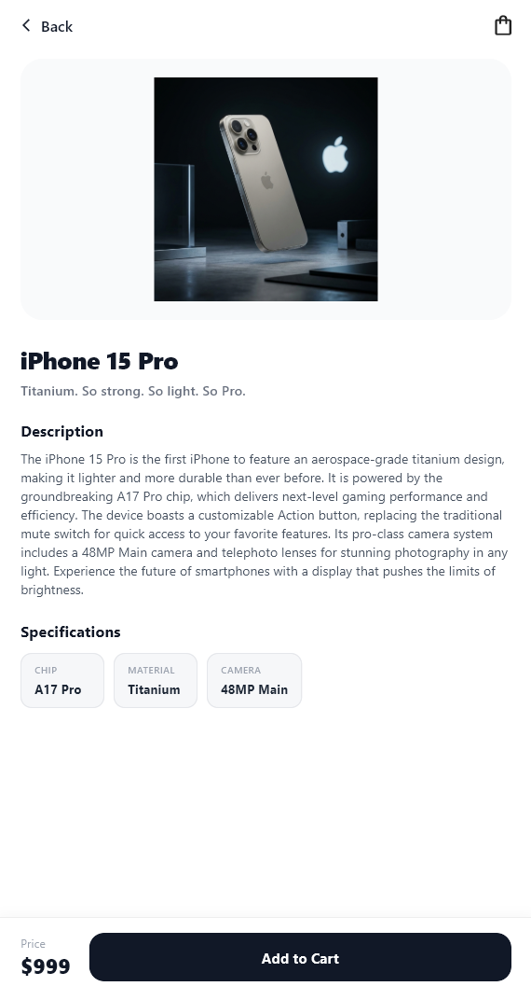
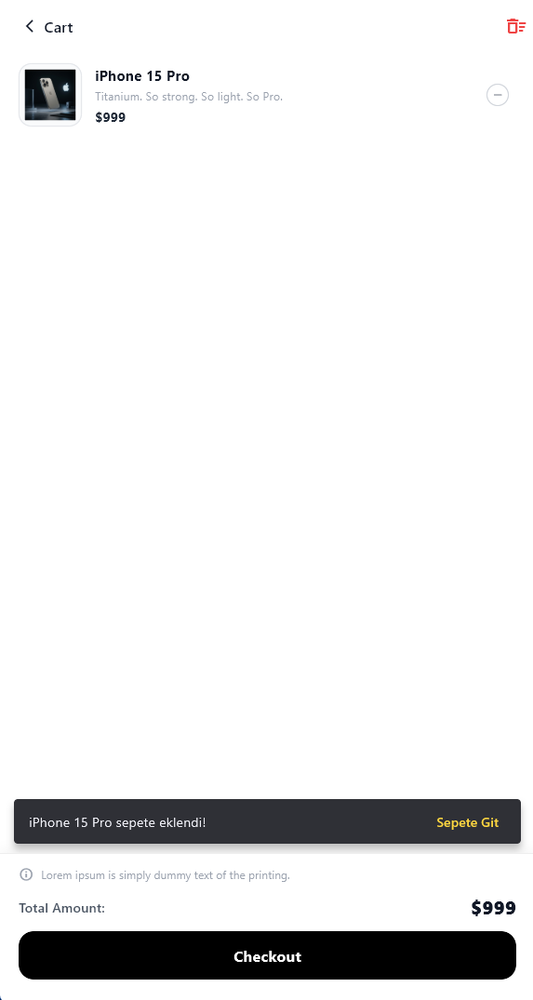
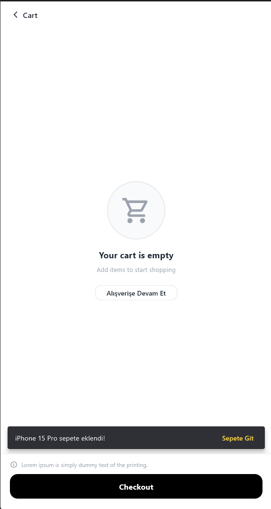

# Mini Katalog

Flutter ile geliştirilmiş, teknolojik ürünlerin sergilendiği, filtrelendiği ve sepet yönetiminin gerçekleştirildiği modern bir mini katalog mobil uygulaması.

**Geliştirici:** Sefa Kesen

---

## Proje Hakkında

Bu proje, mobil uygulama geliştirme standartlarına uygun olarak tasarlanmış bir ürün katalog ve sepet akışı uygulamasıdır. Kullanıcıların teknolojik cihazları keşfetmelerini, arama çubuğu ile ürünleri hızlıca filtrelemelerini, ürünlerin detaylarını ve teknik özelliklerini incelemelerini, sepetlerine ekleyip sipariş sürecini tamamlamalarını sağlar.

Uygulama harici bir üçüncü parti durum yönetimi paketine ihtiyaç duymadan, Flutter'ın yerleşik mimarisi üzerinde reaktif ve performanslı bir yapıda geliştirilmiştir.

---

## Ekran Görüntüleri

| Keşfet (Discover) | Ürün Detayı | Sepet (Dolu) | Sepet (Boş) |
|:---:|:---:|:---:|:---:|
|  |  |  |  |

---

## Ekranlar ve Kullanıcı Deneyimi

### 1. Keşfet (Discover) Ekranı
- **Kampanya Banner'ı:** Üst kısımda kullanıcıları karşılayan görsel promosyon alanı.
- **Canlı Arama & Filtreleme:** Arama çubuğuna yazılan metne göre ürün ismi, sloganı ve açıklamasında anlık filtreleme yapılır. Eşleşme bulunamadığında kullanıcı bilgilendirilir.
- **2 Sütunlu Ürün Izgarası (GridView):** Ürünlerin görselleri, isimleri, sloganları, fiyat bilgileri ve tek dokunuşla sepete ekleme butonları kart yapısında listelenir.
- **Dinamik Bildirim Rozeti (Badge):** Sağ üstteki sepet butonunda, sepette bulunan toplam ürün adedi anlık olarak gösterilir.

### 2. Ürün Detay Ekranı
- **Hero Görsel Animasyonu:** Ana sayfadaki ürün kartına tıklandığında ürün görseli akıcı bir Hero geçişiyle detay sayfasına taşınır.
- **Detaylı Bilgilendirme:** Ürün adı, pazarlama sloganı ve açıklama metni okunaklı bir tipografiyle sunulur.
- **Teknik Özellik Kartları (Specifications):** Ürüne ait çip, batarya, boyut, renk gibi parametreler dinamik kutucuklar (`SpecChip`) halinde listelenir.
- **Sepete Ekleme Alanı:** Ekranın altındaki sabit panelde ürün fiyatı gösterilir; "Add to Cart" butonu ile sepete ekleme yapılır ve kullanıcıya SnackBar ile anlık geri bildirim verilir.

### 3. Sepet Yönetimi Ekranı
- **Dolu Sepet Durumu:** Sepete eklenen tüm ürünler küçük resimleri, isimleri, birim fiyatları ve seçilen adetleri ile listelenir.
- **Miktar Güncelleme:** Ürün adetleri artırılabilir veya azaltılabilir. Adet 1 iken azaltıldığında ürün sepetten otomatik olarak kaldırılır.
- **Sepeti Temizleme:** AppBar üzerindeki buton aracılığıyla onay diyaloğu açılarak tüm sepet tek seferde temizlenebilir.
- **Sipariş Tamamlama (Checkout):** Alt panelde toplam tutar dinamik hesaplanır. "Checkout" butonuna basıldığında sipariş başarı diyaloğu açılır ve sepet sıfırlanarak kullanıcı ana sayfaya yönlendirilir.
- **Boş Sepet Durumu:** Sepette ürün olmadığında kullanıcıyı karşılayan sade illüstrasyon, bilgilendirici mesaj ve doğrudan alışverişe dönmeyi sağlayan buton yer alır.

---

## Mimari ve Teknik Yapı

- **Durum Yönetimi (State Management):** Dış kütüphane bağımlılığı olmadan, saf Flutter bileşenleri olan `ChangeNotifier` (`CartController`) ve `InheritedNotifier` (`CartScope`) kullanılarak inşa edilmiştir. Bu sayede sepet değişiklikleri tüm ekranlara ve sepet rozetine anında yansır.
- **Veri Modeli & Serileştirme:** `Product` ve `CartItem` modelleri ile strongly-typed veri yapısı kurulmuştur. `fromJson` ve `toJson` metotları ile JSON verileri güvenle nesneye dönüştürülür.
- **Yerel Veri Servisi (ProductService):** İnternet bağlantı sorunlarından veya harici API kesintilerinden etkilenmemesi için ürün verileri ve 21 adet ürün görseli yerel varlıklar (`assets/data/products.json` ve `assets/images/`) üzerinden yüklenir.
- **Tasarım Standartları:** Material 3 tabanlı, Apple/Minimalist açık renk paletine sahip, modern köşe yuvarlatmaları ve gölgelendirmelerle hazırlanmış tutarlı arayüz.

---

## Proje Dizin Yapısı

```text
lib/
├── models/
│   ├── product.dart          # Ürün veri modeli (fromJson, toJson, fiyat ve görsel yardımcıları)
│   └── cart_item.dart        # Sepetteki ürün ve miktar modeli
├── screens/
│   ├── home_screen.dart      # Keşfet ekranı, arama filtreleme ve ürün ızgarası
│   ├── product_detail_screen.dart # Hero animasyonlu detay sayfası ve teknik özellikler
│   └── cart_screen.dart      # Dolu ve boş sepet durumları, adet yönetimi ve checkout
├── services/
│   └── product_service.dart  # Yerel JSON verilerini yükleyen servis
├── state/
│   └── cart_state.dart       # ChangeNotifier ve InheritedNotifier tabanlı sepet yönetimi
├── widgets/
│   ├── banner_card.dart      # Promosyon banner bileşeni
│   ├── cart_icon_button.dart # Dinamik rozetli sepet ikonu
│   ├── product_card.dart     # Izgara görünümündeki ürün kartı
│   ├── product_image.dart    # Hata yakalamalı yerel görsel bileşeni
│   └── spec_chip.dart        # Teknik özellik kutucuğu
└── main.dart                 # Uygulama başlangıcı, CartScope sarmalaması ve rota tanımları
```

---

## Testler ve Doğrulama

Projede hem birim hem de arayüz duman testleri yer almaktadır:

- **Model Birim Testi:** `Product` modelinin JSON dönüşüm doğrulaması.
- **Durum (State) Testi:** `CartController` üzerinde sepete ürün ekleme, çoklu adet yönetimi, ürün çıkarma, sepet temizleme ve toplam tutar hesaplama kontrolleri.
- **Arayüz Duman Testi (Smoke Test):** Ana sayfa bileşenlerinin (arama çubuğu, başlık, sepet butonu) sorunsuz bir şekilde yüklendiğinin doğrulanması.

---

## Kurulum ve Çalıştırma

Projeyi yerel ortamınızda çalıştırmak için aşağıdaki adımları uygulayabilirsiniz:

1. **Bağımlılıkları Yükleyin:**
   ```bash
   flutter pub get
   ```

2. **Kod Analizini ve Testleri Çalıştırın:**
   ```bash
   flutter analyze
   flutter test
   ```

3. **Uygulamayı Başlatın:**
   ```bash
   flutter run
   ```
